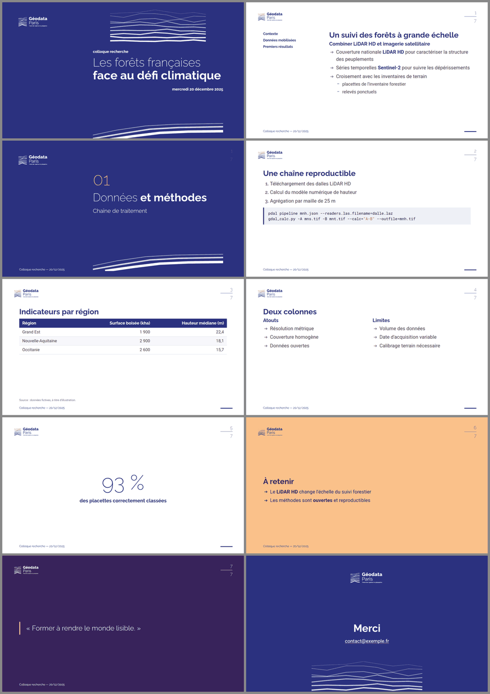

# skills

Collection d'[Agent Skills](https://docs.claude.com/en/docs/agents-and-tools/agent-skills/overview)
pour Claude Code / Claude.

| Skill | Description |
| --- | --- |
| [marp-geodata](skills/marp-geodata/SKILL.md) | Présentations [Marp](https://marp.app/) conformes à la [charte graphique de Géodata Paris](https://geodata-paris.fr/fr/charte-graphique-et-outils) (thème `geodata` + règles d'écriture de la marque). |

## Installation

### Vercel Skills CLI (recommandé)

```bash
# Installer toutes les skills
npx skills add mborne/skills

# Installer une skill spécifique
npx skills add mborne/skills --skill marp-geodata
```

> Tant que le dépôt est privé, l'installation nécessite un accès Git
> authentifié à `github.com/mborne/skills`.

### Claude Code

```bash
npx skills add mborne/skills -a claude-code
```

Alternative via la marketplace de plugins Claude Code :

```text
/plugin marketplace add mborne/skills
/plugin install mborne-skills@mborne-skills
```

### OpenCode

```bash
npx skills add mborne/skills -a opencode
```

### Manuelle

Copier (ou lier) le dossier du skill dans `~/.claude/skills/` (skills
personnels) ou `.claude/skills/` d'un projet :

```bash
git clone git@github.com:mborne/skills.git
ln -s "$PWD/skills/skills/marp-geodata" ~/.claude/skills/marp-geodata
```

## marp-geodata



Source de l'exemple : [`skills/marp-geodata/examples/exemple.md`](skills/marp-geodata/examples/exemple.md).

```bash
cd skills/marp-geodata
npx -y @marp-team/marp-cli@latest --html --theme-set theme/geodata.css examples/exemple.md -o exemple.pdf
```

Le thème est une interprétation de la charte (octobre 2025) pour Marp ; il ne
remplace pas le modèle PowerPoint officiel. Les logos de `assets/` sont la
propriété de Géodata Paris et sont repris tels que publiés sur
<https://geodata-paris.fr/fr/charte-graphique-et-outils>.
