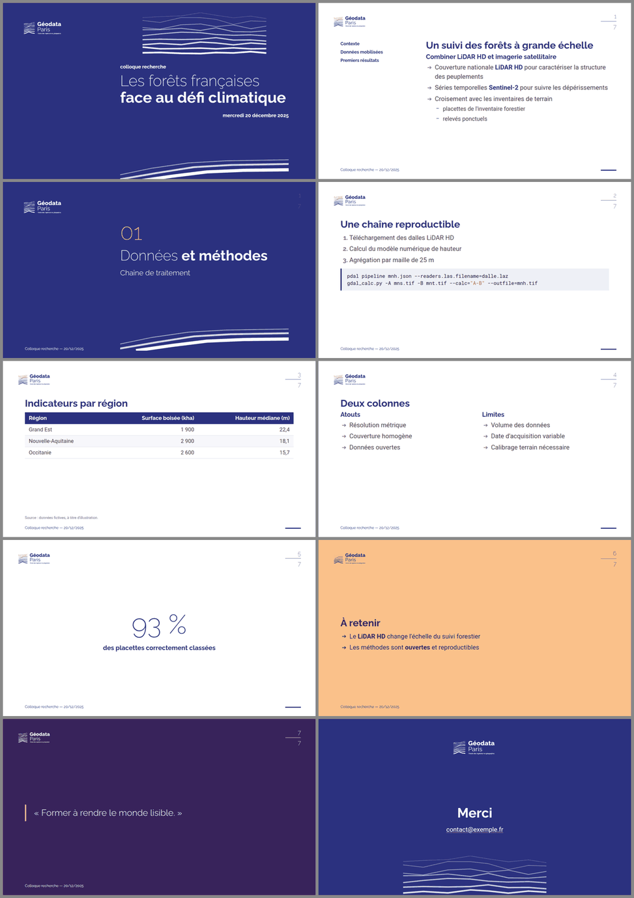

# marp-geodata

Présentations [Marp](https://marp.app/) conformes à la
[charte graphique de Géodata Paris](https://geodata-paris.fr/fr/charte-graphique-et-outils)
(thème `geodata` + règles d'écriture de la marque). Voir [SKILL.md](SKILL.md)
pour les instructions de la skill.



Source de l'exemple : [`examples/exemple.md`](examples/exemple.md).

```bash
cd skills/marp-geodata
npx -y @marp-team/marp-cli@latest --html --theme-set theme/geodata.css examples/exemple.md -o exemple.pdf
```

Le thème est une interprétation de la charte (octobre 2025) pour Marp ; il ne
remplace pas le modèle PowerPoint officiel. Les logos de `assets/` sont la
propriété de Géodata Paris et sont repris tels que publiés sur
<https://geodata-paris.fr/fr/charte-graphique-et-outils>.
